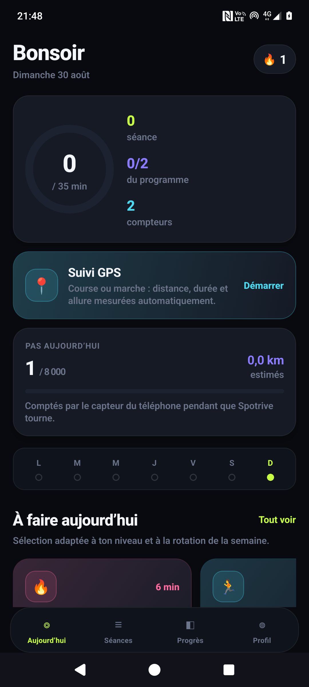
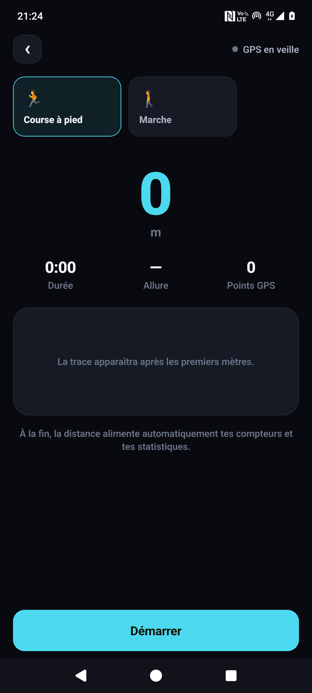
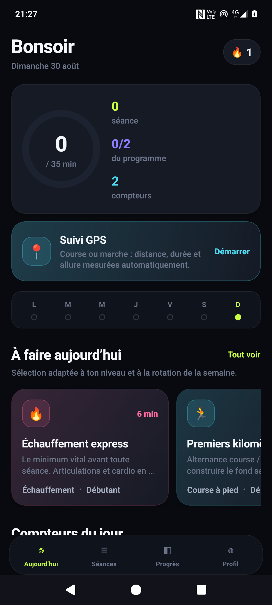
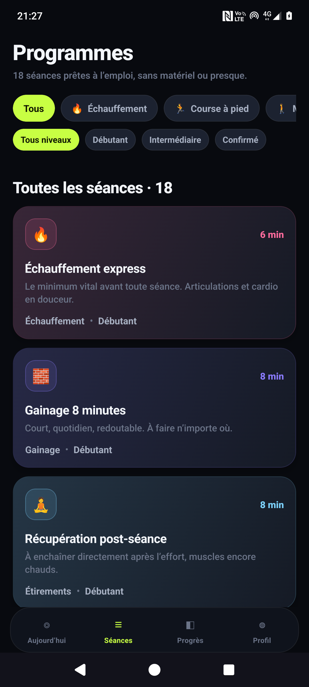
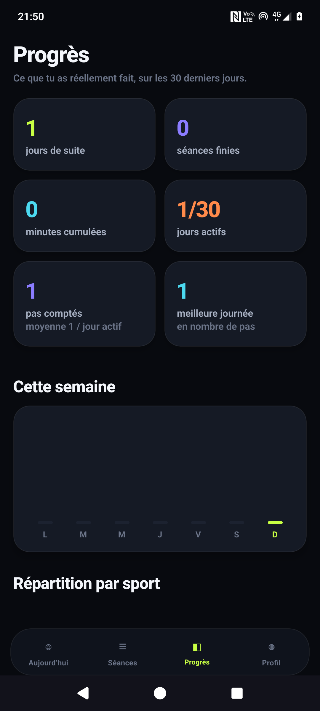
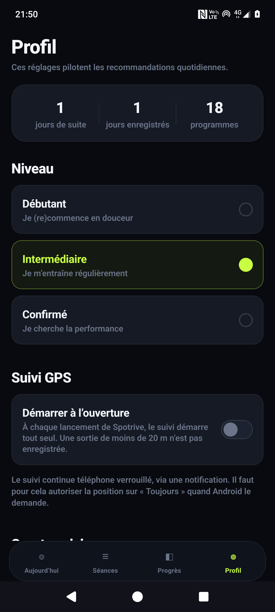

<div align="center">

# Spotrive

**Application Android de suivi sportif : séances guidées, compteurs, et suivi GPS de tes courses.**

Hors ligne · sans compte · sans publicité · sans traqueur

React Native · Expo SDK 57 · React 19

</div>

---

## Ce que ça fait

Tu coches ou tu incrémentes ce que tu viens de faire, l'app suit le volume, les minutes et ta série de jours.
Quand tu cours ou que tu marches, le GPS mesure tout à ta place — y compris **téléphone verrouillé dans la poche**.

| Aujourd'hui | Suivi GPS | Compteurs |
|---|---|---|
|  |  |  |

| Séances | Progrès | Profil |
|---|---|---|
|  |  |  |

### Les fonctions

> **Une limite à connaître sur les pas.** Android ne donne pas l'historique du capteur de pas aux
> applications tierces. Spotrive compte donc les pas pendant qu'elle tourne — ce qui couvre toute la
> durée d'une activité GPS, écran verrouillé compris, mais pas les heures où l'app est complètement
> fermée. C'est le prix à payer pour ne dépendre d'aucun service tiers.

**Suivi GPS (course et marche)**
Distance, durée, allure et vitesse en direct, avec la trace du parcours dessinée en SVG (pas de carte, donc
pas de clé d'API ni de requête réseau). Le suivi tourne dans un *service de premier plan* Android : tu peux
verrouiller ton téléphone et le mettre dans ta poche, la mesure continue. Option « démarrer à l'ouverture »
pour ne même pas avoir à appuyer sur un bouton. Les points GPS sont filtrés (précision, pas minimum, vitesse
plausible) pour qu'une trace immobile n'invente pas des mètres.

**Podomètre**
Le capteur de pas matériel du téléphone alimente un compteur quotidien, avec objectif selon ton niveau
et distance estimée. Pendant une sortie GPS, les pas de la sortie sont comptés séparément — même écran
verrouillé, puisque le service de premier plan garde l'app en vie.

**Compteurs**
Pour tout ce qui se fait sur place — pompes, squats, gainage — un simple `+` / `−`, avec appui long pour
défiler vite et un cercle qui valide l'objectif d'un coup.

**18 séances guidées, 44 exercices**
Échauffement (express, complet), course à pied (premiers kilomètres, fractionné 30"/30", seuil, côtes,
sortie longue), marche, torse (3 niveaux), gainage et abdos, jambes, étirements. Chaque série se coche
individuellement, avec le conseil d'exécution de l'exercice et un minuteur de repos de 60 s automatique.

**Recommandations du jour**
Une rotation hebdomadaire qui évite d'enchaîner deux fois le même groupe musculaire, filtrée par ton niveau
et par les sports que tu suis.

**Progrès**
Série de jours consécutifs, séances terminées, minutes cumulées, distance GPS totale, meilleure allure,
pas cumulés et meilleure journée, graphe de la semaine, répartition par sport, volume par exercice,
historique. Tout se cumule tout seul : 5 km courus remplissent la « sortie longue », les pas remplissent
le compteur « pas de la journée », une marche de 25 min remplit la « marche active ».

---

## Installer l'app

### Option 1 — l'APK tout prêt

Télécharge le dernier `spotrive.apk` depuis la page [Releases](../../releases), ouvre-le sur ton téléphone
et accepte l'installation depuis une source inconnue (Android le propose tout seul).

Android 7.0 (API 24) minimum, architecture `arm64-v8a` — c'est-à-dire tous les téléphones vendus depuis 2017.

> L'APK publié est signé avec la clé de debug d'Android. C'est parfait pour l'installer soi-même,
> mais ce n'est pas une signature de distribution : pour publier sur le Play Store, génère ta propre
> clé (`keytool -genkeypair`) et référence-la dans `android/app/build.gradle`.

### Option 2 — la compiler soi-même

Il te faut **Node 20+**, un **JDK 17 ou 21**, et le **SDK Android** (platform 36, build-tools 36, NDK 27, CMake).

```bash
git clone https://github.com/micferna/spotrive.git
cd spotrive
npm install

# génère le projet natif android/ (il n'est pas versionné)
npx expo prebuild -p android

# compile un APK release, téléphone branché en USB avec le débogage activé
cd android
./gradlew :app:assembleRelease -PreactNativeArchitectures=arm64-v8a
adb install -r app/build/outputs/apk/release/app-release.apk
```

Si `sdkmanager` n'est pas installé :

```bash
sdkmanager --install "platform-tools" "platforms;android-36" "build-tools;36.0.0" \
                     "ndk;27.1.12297006" "cmake;3.22.1"
echo "sdk.dir=$HOME/Android/Sdk" > android/local.properties
```

### Option 3 — développer sans rien compiler

```bash
npm start          # scanne le QR code avec Expo Go
```

Attention : le suivi GPS en arrière-plan ne fonctionne pas dans Expo Go, il faut un vrai build.

### Option 4 — build dans le cloud

```bash
npx eas-cli build -p android --profile preview     # APK
npx eas-cli build -p android --profile production  # AAB pour le Play Store
```

---

## Permissions demandées

| Permission | Pourquoi |
|---|---|
| `ACCESS_FINE_LOCATION` | Mesurer la distance et l'allure. |
| `ACCESS_BACKGROUND_LOCATION` | Continuer la mesure téléphone verrouillé. Sans elle, l'app garde l'écran allumé à la place. |
| `FOREGROUND_SERVICE_LOCATION` | Le service qui porte la notification « activité en cours ». |
| `ACTIVITY_RECOGNITION` | Lire le capteur de pas du téléphone. |

Sur Android 11+, « Toujours autoriser » ne peut pas être accordé depuis la popup : Android renvoie vers
*Réglages → Autorisations → Position*. L'app propose le raccourci au moment où c'est nécessaire.

**Aucune donnée ne quitte le téléphone.** Pas de compte, pas de serveur, pas d'analytics : tout est
stocké en local dans `AsyncStorage`, et l'app n'ouvre aucune connexion réseau.

---

## Architecture

```
App.js                    navigation (onglets + écrans plein écran), safe areas, retour Android
src/theme.js              tokens de design : couleurs, rayons, typographie
src/data/catalog.js       44 exercices, 18 programmes, moteur de recommandation
src/lib/geo.js            haversine, allures, projection de la trace GPS
src/lib/tracker.js        suivi GPS : tâche d'arrière-plan, filtres, pause/reprise, reprise après kill
src/lib/steps.js          podomètre : abonnement au capteur, propagation par incréments
src/lib/dates.js          clés de jour, formats français
src/store/store.js        contexte React + reducer + persistance (écriture différée 400 ms)
src/store/selectors.js    logique pure : volumes, minutes, ratios, streak, cumuls GPS
src/components/           Squeeze, Ring, Bar, Chip, Toggle, TrackerRow, ProgramCard, TabBar
src/screens/              Today, Activity, Programs, Session, Stats, Profile, Onboarding
tests/                    tests de la logique métier, sans dépendance à React Native
```

### Choix de performance

- **Aucune bibliothèque de navigation.** Les onglets restent montés : changer d'onglet ne remonte rien
  et ne perd pas le scroll.
- **`TrackerRow` mémoïsée avec un comparateur explicite.** Sur une séance de 30 séries, appuyer sur `+`
  ne re-rend qu'une seule ligne.
- **Animations sur le thread natif** (`useNativeDriver`) pour les pressions et l'anneau de progression.
- **Écriture disque debouncée à 400 ms** : marteler `+` n'écrit jamais dans `AsyncStorage`.
- **Trace GPS sous-échantillonnée à 300 points** avant enregistrement, et projetée en SVG plutôt que
  rendue par une carte.
- **Catalogue statique indexé à la compilation** : aucun fetch, aucun parsing au démarrage.

### Tests

```bash
npm test
```

20 tests couvrent la logique métier sans émulateur : cohérence du catalogue, dépliage des séries,
ratios d'avancement, calcul des minutes, streak (y compris les trous et la journée en cours vide),
recommandations sur 14 jours × 3 niveaux, distances haversine, formats d'allure, projection de trace,
cumuls de pas, et rétrocompatibilité des données enregistrées avant l'ajout du GPS.

---

## Licence

MIT — voir [LICENSE](LICENSE).
